# Changelog

Every release of the `cedr` CLI, newest first. The GitHub release notes for a version are its entry here. The design contracts are [docs/route.md](docs/route.md) (Route and the MCP server), [docs/council.md](docs/council.md) (Council), [docs/design.md](docs/design.md) (Guard), [docs/sync.md](docs/sync.md) (Sync), [docs/monitor.md](docs/monitor.md) (Monitor), [docs/bench.md](docs/bench.md) (Bench), [docs/doctor.md](docs/doctor.md), [docs/update.md](docs/update.md) and [docs/telemetry.md](docs/telemetry.md); the user guides are at [cedr.dev/docs](https://cedr.dev/docs).

## v0.10.0 (2026-11-06)

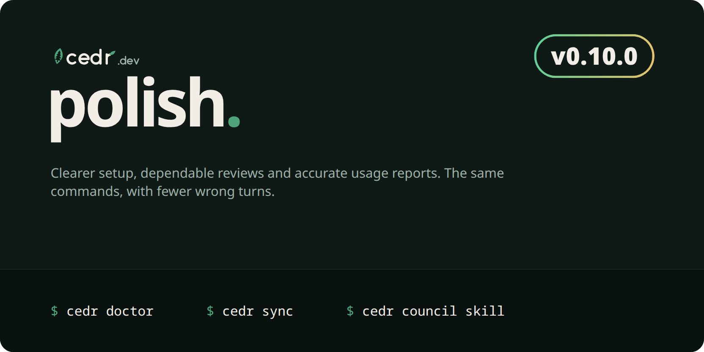

**v0.10.0** · 26 changes from 1 contributor

### Highlights
**Start locally without an account.** `cedr doctor` skips the optional API key when no organization is configured and skips Monitor sources absent from the machine and push scheduling without an organization. Route parse errors include the loader's path and reason. Missing model lists and misspelled efforts now get actionable Route diagnostics, and the README's Route quick start includes Claude's model list.

**Keep shared instructions and hand edits under control.** Sync accepts direct `CLAUDE.md` and `GEMINI.md` links to the repo's `AGENTS.md`, preserves file permissions, and says which source needs a hand edit and what `--force` discards.

**Review reports must contain a review.** Council refuses empty and failed text replies, accepts common Markdown formatting, and reports malformed findings instead of silently losing them. Its MCP tool now publishes the report objects clients should send.

### Breaking
- **Text review completion:** a text report without findings must include a valid `Score: <n>/10` or `No findings.` line. Empty, failed and malformed finding reports return exit 2. JSON reports with `"findings": []` remain valid.
  **Upgrade step:** have reviewers use the format from `cedr council skill`, or submit JSON reports. Fix any finding line the merge names before retrying.
- **Doctor's optional account:** without an organization configured, a missing API key is `skip` and no longer makes the command exit 1. Invalid keys still fail, as do missing keys when hosted features require one.
  **Upgrade step:** account-health scripts should inspect `key.present` and `key.valid` in `--format json` instead of using Doctor's exit code as proof of an account.

### Fixes
- **Council:** refuses numbered reviews past the route's last allowed review, distinguishes reviews from revisions in text output, and preserves findings for filenames containing spaces and delimiters, handles mixed separators, lowercase severity and line-column locations, normalizes list markers, headings, blockquotes and bold labels, and ignores commentary in the documented earlier-fix form.
- **Sync:** imports Claude's `Bash(git:*)` and `Bash(rm:*)` as command prefixes for every supported target; existing generated instruction files can become shared links without stale lock ownership blocking the change. New Unix files follow the umask; replaced files keep their permissions.
- **Monitor:** counts and costs sessions by harness and session id together, keeping separate sessions separate without changing stored data or push shapes.
- **Guard:** rejects non-object JSON MCP configuration roots before writing a lock. Clean text lint output names the number of instruction files, skills and servers checked; JSON and GitHub output keep their shapes.
- **CLI guidance:** hides the legacy top-level `remote` command while keeping it working, aligns help examples and Route statistics, groups Doctor checks by product, and explains the steps after `cedr bench init`.

Full changelog

#### What's Changed
* fix(council): stop merges past the last review and say rounds counts revisions
* chore(release): ship the council last review cap as cedr 0.9.4
* fix(council): reject text reports that never finished or drop findings
* fix(mcp): publish council_merge reports as report objects
* fix(doctor): warn on harnesses with no model list and skip an unneeded key
* fix(cli): hide the legacy remote command and align help examples
* fix(route): give every route stats column a fixed width
* fix(sync): say where hand edits belong when refusing a file
* fix(sync): keep a CLAUDE.md or GEMINI.md link to AGENTS.md
* fix(sync): import Claude's Bash(git:*) permissions as shell:git
* fix(monitor): count and cost sessions by harness and id
* fix(guard): reject JSON agent configs that are not objects
* fix(cli): say what comes next after bench init and a clean guard lint
* feat(doctor): warn on route efforts off the ladder that no model offers
* style: satisfy clippy in the doctor key check and sync link test
* fix(doctor): trust the codex reader's model list in route.targets
* fix(cli): preserve review findings and reduce setup friction
* fix(council): locate finding fields by severity and reject lost formats
* fix(cli): normalize review containers and scope effort diagnostics
* chore(release): prepare cli feature polish as cedr 0.10.0
* fix(council): reject decorated severity prefixes before merging
* fix(cli): reject incomplete findings and explain route setup errors
* fix(council): group findings when only the filename is marked up
* fix(council): reject labelled severity findings and normalize underscores
* fix(council): preserve literal filename characters in marked locations
* fix(council): distinguish verification prose from finding labels

**Full Changelog**: https://github.com/Sheernox/cedr/compare/v0.9.3...v0.10.0

## v0.9.4 (2026-11-05)

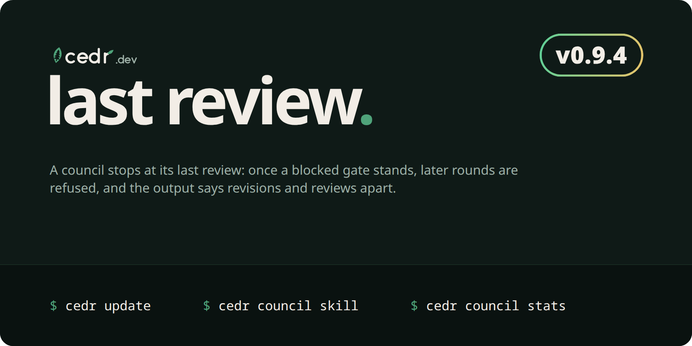

**v0.9.4** · 2 changes from 1 contributor

**Release status:** included in v0.10.0 without a separate release.

### Highlights
**A council stops at its last review.** A route's `rounds` counts revisions, so `rounds = 3` allows four reviews. Once the last one blocks, the gate stands: `cedr council merge` and the `council_merge` MCP tool now refuse a later `--round` (exit 2) and record nothing, so a run can no longer pass after its gate stood.

### Fixes
- **Council merge:** a numbered `--round` past `rounds + 1` is a usage error naming the last review. Unlimited rounds are unchanged.
- **Council text:** `next: revise (revision N of M)` and the brief title `(revision N of M)` count revisions; `cedr route history` prints council records as `review <round> of <rounds + 1>`, so the last review reads `review 4 of 4`, not `round 4/3`. JSON is unchanged.
- **Council stats:** text labels the run counts `revised_runs` and `passed_after_revision_runs`; they count runs, not revisions, as the JSON fields `revised` and `passed_after_revision` always have.
- **Council skill:** the score table in `cedr council skill` counts reviews (`Reviews: 2`, `Review 1`).

Full changelog

#### What's Changed
* fix(council): stop merges past the last review and say rounds counts revisions
* chore(release): ship the council last review cap as cedr 0.9.4

**Full Changelog**: https://github.com/Sheernox/cedr/compare/v0.9.3...1b97b715c60031f1606a41a787b091d4151d086b

## v0.9.3 (2026-11-05)

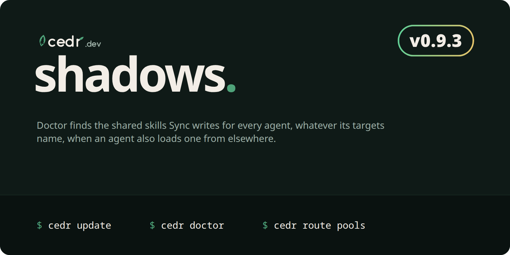

**v0.9.3** · 2 changes from 1 contributor

### Highlights
**`sync.shadowed` checks the shared skills folder in every repo.** Sync writes every skill into `.agents/skills/` whatever `targets` names, so `cedr doctor` now reports a skill there that Codex, Antigravity, Cursor or opencode also loads from elsewhere, even when `targets` names only another agent.

### Fixes
- **Doctor:** `sync.shadowed` counts the shared `.agents/skills/` folder for the agents that read it in every repo with Sync skills, and still checks Claude's and Grok's own folders only when `targets` names them.

Full changelog

#### What's Changed
* fix(doctor): count shared skills sync writes whatever its targets
* chore(release): ship shared skill shadow checks as cedr 0.9.3

**Full Changelog**: https://github.com/Sheernox/cedr/compare/v0.9.2...v0.9.3

## v0.9.2 (2026-11-05)

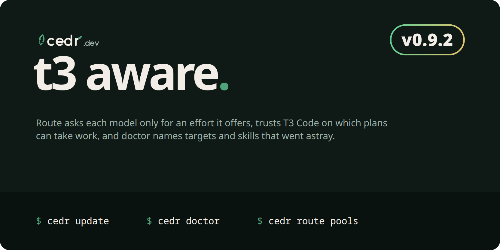

**v0.9.2** · 2 changes from 1 contributor

### Highlights
**Picks ask each model only for an effort it offers.** When T3 Code (or any readings source) lists a model's effort option, an effort the model lacks becomes the nearest it offers (Grok's `max` becomes `xhigh`), the reason says so, and a harness whose routes name no effort option still gets its effort through T3 Code.

**T3 Code decides which plans can take work.** On a machine that reads T3 Code, a provider disabled or signed out there counts as absent, and one T3 Code reports installed counts as present, even with nothing on `PATH`.

**Doctor finds routes and skills that went astray.** `route.targets` names route targets no offered model matches, and `sync.shadowed` names Sync skills that an agent also loads from its user folder under the same name.

This patch adds readings fields (`efforts`, `plans`), a machine snapshot field and two doctor checks, which `docs/versioning.md` would make a minor; the maintainers chose to ship them in 0.9.2.

### Features
- **Model options:** readings may carry `efforts` (each model's effort option id and values) and `plans` (the subscription a harness is signed in with); the `t3` reader fills both from T3 Code. A delegate's effort, tag and T3 target use the effort the model offers.
- **T3 Code's view:** with a `t3` readings source, T3 Code's provider cache, when checked within the hour, makes a disabled or signed-out plan absent and an installed one present.
- **Machine snapshot:** `cedr route sync` sends `plans`, so the app can show which subscription each machine's plans use.
- **Doctor:** new `route.targets` and `sync.shadowed` checks.

### Fixes
- **Antigravity pools:** model families are capped after they are deduplicated, so many versions of one family cannot crowd out another.

Full changelog

#### What's Changed
* feat(route): use t3 code's model options, provider health and skill lists
* chore(release): ship t3 code model options as cedr 0.9.2

**Full Changelog**: https://github.com/Sheernox/cedr/compare/v0.9.1...v0.9.2

## v0.9.1 (2026-11-05)

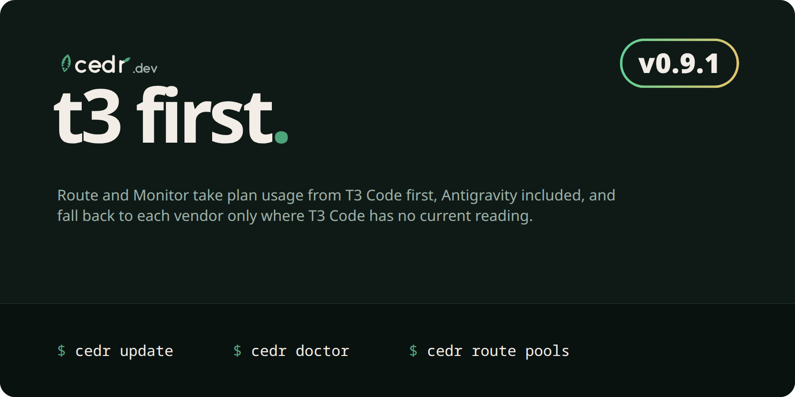

**v0.9.1** · 5 changes from 1 contributor

### Highlights
**Under T3 Code, plan usage comes from T3 Code first.** A new `t3` readings source reads what T3 Code last read of every plan it runs, Antigravity included, from its own provider caches, running nothing and reading no credentials. Each plan it has no current reading for falls through to the next source, so the vendor readers stay as fallbacks. `cedr monitor limits` reads it first too, so Antigravity's limits now appear there.

**Upgrade step:** on a machine running T3 Code, add `[[readings]]` with `kind = "t3"` as the first readings source in `~/.config/cedr/routes.toml`, or rerun "Set up this machine" in the app. `cedr doctor` (`route.readers`) warns while it is missing.

This patch adds a config value (`kind = "t3"`), which `docs/versioning.md` would make a minor; the maintainers chose to ship it in 0.9.1. An older cedr refuses a routes file that uses it.

### Features
- **T3 Code readings:** `kind = "t3"` reads `$T3CODE_HOME/caches/<instance>.json` for each plan harness (its `t3` id), taking usage windows, reset times and the offered models. Claude's model windows, Antigravity's Argon pool and its pools for other vendors' models are scoped to their families; Grok's window keeps the `grok` reader's id. A reading older than `fresh_seconds` is skipped, so the next source supplies it.
- **Doctor:** `route.readers` warns when T3 Code runs on the machine and no source reads it, and `route.statusline` is ok when T3 Code supplies Claude's reading.

### Fixes
- **Stale readers:** `cedr doctor` lists only the stale readers a pick warns about, never a harness missing from the machine or one a feed already covers.
- **Family-named orchestrator:** an orchestrator or manual pick named by family (`opus`) with no model list takes the limits scoped to its versions (`opus-4-5`).
- **Monitor schedule:** a timer installed after boot now runs two minutes after install on Linux and Windows, and at load on macOS, instead of waiting for a reboot.
- **opencode:** a database in opencode's newer schema is reported as `unsupported`, naming the schema, instead of an error.
- **Monitor limits:** a run-out time at or after the window's reset is shown as none, and text output rounds the elapsed share to a whole percent.
- **Antigravity:** interrupted generations no longer count as malformed, so `monitor.sources` warns only on records Cedr cannot decode.

Full changelog

#### What's Changed
* fix(monitor): start schedules on install and stop counting normal use as errors
* fix(doctor): list only the stale readers a pick warns about
* fix(route): apply version-scoped limits to a model named by family
* feat(route): read plan usage from T3 Code first
* chore(release): ship t3 code readings as cedr 0.9.1

**Full Changelog**: https://github.com/Sheernox/cedr/compare/v0.9.0...v0.9.1

## v0.9.0 (2026-11-05)

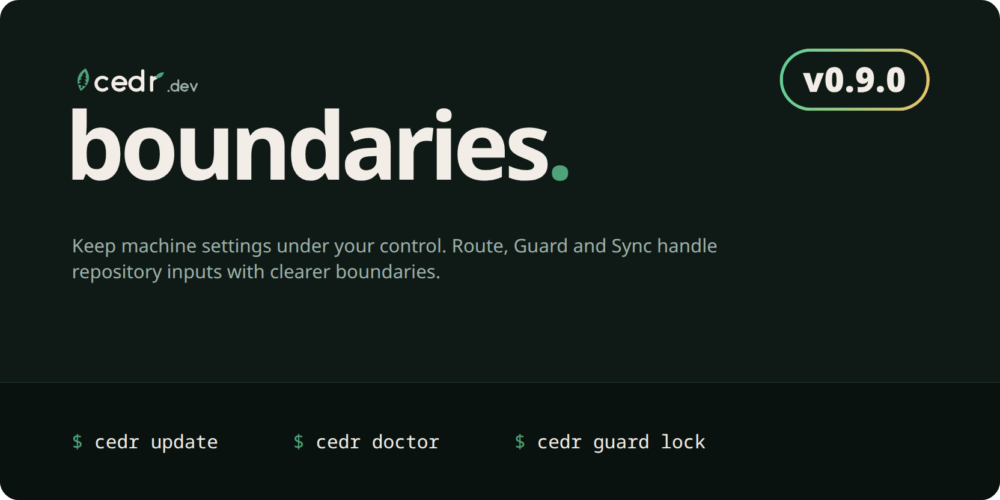

**v0.9.0** · 8 changes from 1 contributor

### Highlights
**Route sees your Claude plan when Claude Code runs headless.** The `claude-statusline` reader also reads the plan usage Claude Code keeps for itself, so orchestrators that run Claude Code through its SDK, T3 Code among them, get Claude readings with no status line. Only that usage cache is read, never credentials, and nothing leaves your machine. `cedr doctor` says why Claude has no reading when it still has none.

**Model limits only limit their own models.** A weekly limit that applies to one model family, such as Fable's, is labelled by its family in pools and route tags (`claude s39% w45% fable2%`) and no longer counts against every other model.

**Your orchestrator shows in every tag again.** A `[orchestrator]` in your own `routes.toml` now applies over your organization's shared routes, so tags keep the delegating plan's use.

**Upgrade step:** if your routes come from your organization and tags show no orchestrator, add `[orchestrator]` with `harness` and `model` (for example `harness = "claude"`, `model = "opus"`) to `~/.config/cedr/routes.toml`. Run `cedr doctor` and check `route.orchestrator`.

### Features
- **Claude usage cache:** `claude-statusline` takes the newer of the status line capture and Claude Code's own usage cache, and keeps the model windows only the cache has. `cedr monitor limits` stores the cache too.
- **Model windows:** a readings window may name its family with `model` and its own read time with `fetchedAt`. A family ending in a version matches only that version (`opus-4-5:7%`).
- **Machine orchestrator:** a machine's `[orchestrator]` applies over shared routes, and over a repository routes file that sets none. The new `route.orchestrator` doctor check warns when no orchestrator is set.
- **T3 Code agents:** a harness whose program is not on `PATH` is present when T3 Code runs it from a provider profile, Antigravity among them. `docs/route.md` describes the readings an Antigravity source should report.

### Fixes
- **Quiet readers:** a built-in reader no longer runs or warns for a plan an earlier readings source already read.
- **Pools:** `cedr route pools` and the sync snapshot list a row for every model window family a route can pick, including versions an evaluation holds back.

Full changelog

#### What's Changed
* feat(route): count agents that t3 code runs as present on the machine
* fix(route): read claude plan usage without a status line
* fix(route): keep claude model windows scoped and listed
* fix(route): age carried claude windows and match scoped families by id
* fix(route): age carried claude windows per window and warn when they are lost
* fix(route): match versioned families exactly and keep source-scoped feeds shared
* fix(route): list pool rows for model versions an evaluation holds
* chore(release): ship route readings as cedr 0.9.0

**Full Changelog**: https://github.com/Sheernox/cedr/compare/v0.8.4...v0.9.0

## v0.8.4 (2026-11-05)

**v0.8.4** · 5 changes from 1 contributor

### Highlights
**Machine settings stay under your control.** Repository routes can override routing, while executable readings, sync destinations and machine identity come from your user configuration or a file you explicitly trust. Guard and Sync also validate repository inputs before using them.

**Upgrade step:** move repository `[[readings]]`, `[sync]` and `[machine]` sections into `~/.config/cedr/routes.toml`. Run `cedr doctor` to find ignored settings. Only use `--config` or `CEDR_ROUTES` for files you trust to execute commands and receive your API key.

### Breaking
- **Repository config:** automatically discovered machine sections are ignored with a warning. Absolute harness command paths are refused in repository routes.
- **Symlink pins:** skills containing symlinks report CV001 until re-locked with `cedr guard lock`. Regular-file pins remain valid. This also affects Actions downloading the latest CLI; pin a release when coordinating an upgrade.
- **Redacted locks:** newly written Guard locks omit URL user info, queries and fragments. Older clients may report CV004 on these locks. Re-lock old files and rotate any credentials that reached Git history. URL paths remain visible; keep secrets in headers or environment variables.
- **Sync ownership:** invalid lock versions, paths, targets or owned keys are refused, even with `--force`. Remove invalid entries or regenerate the lock. A lock entry cannot silently authorize replacing handwritten instructions.
- **Skill frontmatter:** YAML nesting, including alias expansion, is limited to 128 levels. Recursive aliases are refused with a lint finding.

### Fixes
- **Guard:** distinguish files from symlinks, validate live remote configuration against its pinned launch, and invalidate cached remote results when that configuration changes.
- **Route:** sanitize failed readings requests and run built-in account probes outside the current checkout. Doctor reports ignored repository machine settings.
- **Sync:** validate ownership before writing or deleting files, while preserving unrelated merged settings and legitimate stale outputs.

Full changelog

#### What's Changed
* docs(agents): spell out the release notes format and check it in a test
* docs(changelog): restore the release hero style and redo the 0.8.x notes
* fix: enforce repository input boundaries
* chore(release): prepare cedr 0.9.0
* chore(release): ship security fixes as cedr 0.8.4

**Full Changelog**: https://github.com/Sheernox/cedr/compare/v0.8.3...v0.8.4

## v0.8.3 (2026-11-03)

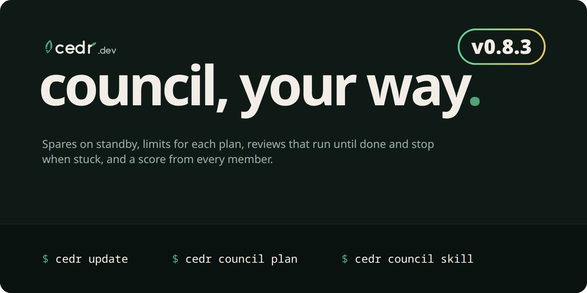

**v0.8.3** · 6 changes from 1 contributor

### Highlights
**Keep members on standby.** Mark a council member `spare = true` and it uses none of its plan until another member can't take a review. Your smallest plan can back up the others without being spent on every change.

**Give each plan its own limits.** A route can now use nearly all of Codex and stop much earlier on Muse, without changing how those plans behave anywhere else.

**Let a review run until it's done.** `rounds = "unlimited"` keeps reviewing while the change improves, and stops by itself when the same blocking findings come back, so it can't loop.

**Your agent knows the procedure.** `cedr council skill` prints the whole review, including how to start members in T3 Code. Agents get settings for who fixes findings, and members can score the change.

**Upgrade step:** upgrade every machine that shares a `routes.toml` before using `harness_thresholds`, `spare`, `fixes`, `advisory`, `spares` or `rounds = "unlimited"`, because older versions refuse the file. Nothing changes for a file that doesn't use them.

### Features
- **Spares:** `spare = true` keeps a member out of a review unless a member can't take it because it is out of plan room, easing off and unable to take this size of work, not installed, or failed partway. `spares = "all"` fills every empty seat and `spares = "quorum"` only as many as the quorum needs. The plan names each stand-in with `spare_for`, and merges record who stood in for whom.
- **Limits per plan:** `[routes."review.council".harness_thresholds.codex]` takes any `thresholds` key and beats the route's own limits for that plan. `cedr route thresholds --route R --harness H` shows and edits them.
- **Unlimited rounds:** pass the last merge's JSON with `--previous`. When every blocking finding returns within 10 lines of where it was, the merge stops with `stalled: true`. This works on numbered rounds too, whenever `--previous` is given.
- **Who acts on findings:** `fixes` says whether the agent fixes blocking findings or asks you, and `advisory` whether it applies, lists or asks about the rest. The plan returns both, so every agent follows them.
- **Named members:** `cedr council plan --member codex/sol` plans exactly the members you name. One that is unavailable is reported, not replaced.
- **Scores:** a report may carry a score out of 10, as `"score": 8` or a `Score: 8/10` line. Merges show scores beside the gate, and they sync to the app as numbers only. A score never decides the gate.
- **Vendor warning:** the plan warns when one vendor alone could reach the quorum, because different vendors miss different things.

### Changes
- Revision briefs now tell the author to fix only what the change needs, and to list anything else as a follow-up.
- Docs and Sync notes say Claude, Gemini, Muse and Grok. Harness ids, targets, paths and JSON are unchanged.

Contracts: [docs/council.md](https://github.com/Sheernox/cedr/blob/v0.8.3/docs/council.md) and [docs/route.md](https://github.com/Sheernox/cedr/blob/v0.8.3/docs/route.md).

Full changelog

#### What's Changed
* feat(route): let a route give one plan its own limits ([#26](https://github.com/Sheernox/cedr/pull/26))
* docs: call agents Claude, Gemini, Muse and Grok everywhere people read ([#26](https://github.com/Sheernox/cedr/pull/26))
* feat(council): let members score a change and keep revisions in scope ([#26](https://github.com/Sheernox/cedr/pull/26))
* feat(council): add spares, unlimited rounds with a stall stop and agent settings ([#26](https://github.com/Sheernox/cedr/pull/26))
* build(banner): render the v0.8.3 release hero ([#26](https://github.com/Sheernox/cedr/pull/26))
* chore(release): cedr 0.8.3 ([#26](https://github.com/Sheernox/cedr/pull/26))

**Full Changelog**: https://github.com/Sheernox/cedr/compare/v0.8.2...v0.8.3

## v0.8.2 (2026-11-02)

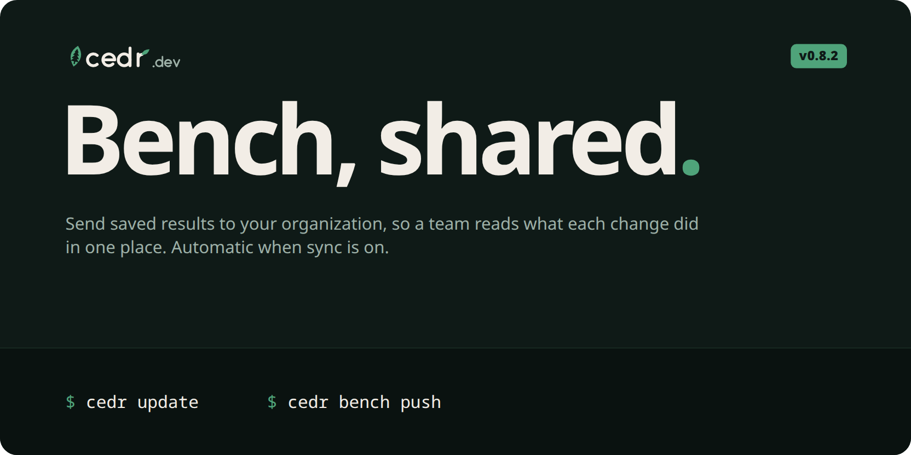

**v0.8.2** · 5 changes from 1 contributor

### Highlights
**Bench results now reach your team.** `cedr bench push` sends saved results to your cedr.dev organization, so everyone reads what each change did in one place. Each result carries its repo name and, on GitHub Actions, its pull request and run.

**Upgrade step:** a machine with `[sync]` set now sends each Bench run when it finishes, unless `auto = false`. To stop it, pass `--no-push` on a run, or set `[sync] auto = false`, which also stops Route's automatic sync. Prompts, agent output and paths are never sent. See [what is sent](https://github.com/Sheernox/cedr/blob/v0.8.2/docs/bench.md).

### Features
- **Pushing:** with no ids, `cedr bench push` sends unsent results saved from the current repo, matched on the repo's name and root commit. Results from other repos stay put unless you name them or pass `--all`, and sending a result twice changes nothing.
- **Automatic sends:** a finished run sends itself under the same rule as Route's automatic sync. A failed send warns and never changes the run's report or exit code, and a busy app is retried.
- **Run details:** runs record the repo name and, on GitHub Actions, the pull request number and run URL. `--repo` sets the name.
- **GitHub Action:** sends results when `push-org` and `CEDR_API_KEY` are set. A failed send only warns, and the Bench gate is unchanged.
- **Doctor:** says whether results are sent automatically, and to which organization.

Full changelog

#### What's Changed
* feat(bench): send results to an organization so a team reads them together
* fix(bench): keep a bare push to the current repo and send no local paths
* fix(bench): match a bare push on the repo's history, and retry a busy app
* build(banner): render the v0.8.2 release hero
* chore(release): cedr 0.8.2

**Full Changelog**: https://github.com/Sheernox/cedr/compare/v0.8.1...v0.8.2

## v0.8.1 (2026-11-01)

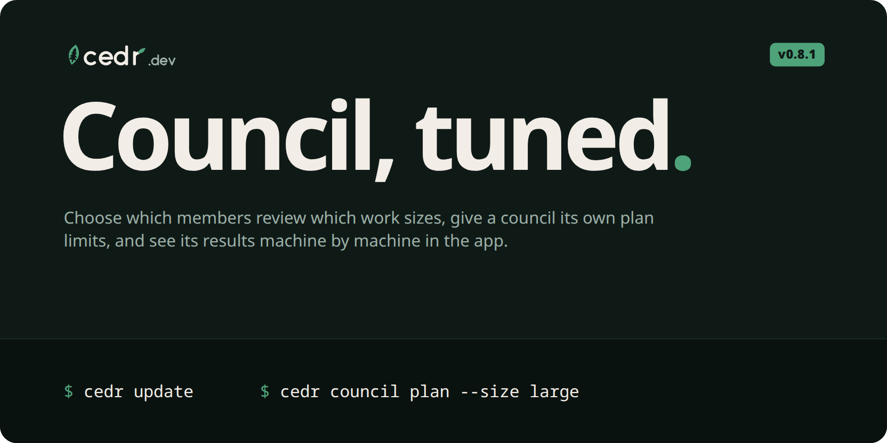

**v0.8.1** · 4 changes from 1 contributor

### Highlights
**Tune a council as finely as any route.** A member can review only the work sizes you choose, so a large change can get more reviewers than a small one. `cedr route sync` also names the machine it pushes from, so the cedr.dev app can show council results per machine.

**Upgrade step:** upgrade every machine that shares a `routes.toml` before setting `sizes` on a council member, because older versions refuse the file.

### Features
- **Work sizes:** council members accept `sizes`, the work sizes each one reviews. Every size must keep at least the quorum of members; validation fails otherwise, since that work could never pass.
- **Machine names:** sync sends this machine's id with each history batch, as `machine` beside `org`. It is left out if the id cannot be read or made, and the records still sync.

Full changelog

#### What's Changed
* feat(council): let members review chosen work sizes
* feat(route): name the machine when pushing history
* build(banner): render the v0.8.1 release hero
* chore(release): cedr 0.8.1

**Full Changelog**: https://github.com/Sheernox/cedr/compare/v0.8.0...v0.8.1

## v0.8.0 (2026-11-01)

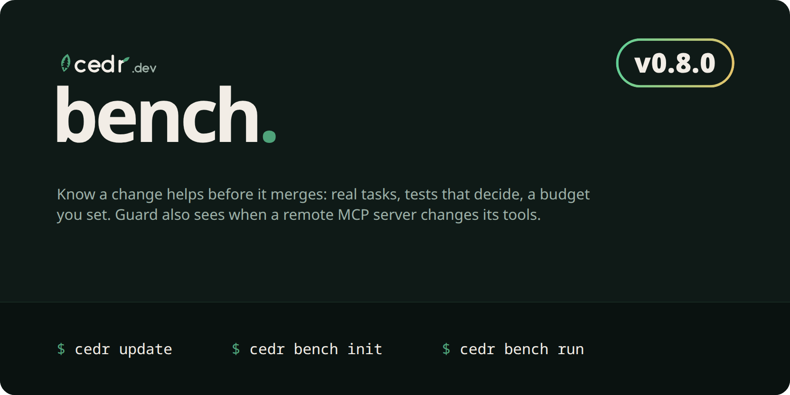

**v0.8.0** · 27 changes from 1 contributor

### Highlights
**Bench is here.** It tells you whether a change to your rules, a skill or a model helps before you merge it: real tasks against a baseline and a candidate, your tests deciding each trial, and a budget on every run that defaults to $2.00. Start with `cedr bench init`.

**Route puts you in charge.** Set plan limits per plan and per route, send different work sizes to different models, and change all of it from the command line. Route and Council can also read Grok's plan usage and balance work onto it.

**Guard watches remote MCP servers.** A remote server has no version, so a pin could never notice its tools changing. `cedr guard remote` compares what a server lists now with what you locked.

**Upgrade step:** none; cedr updates itself. Upgrade every machine that shares a `routes.toml` before using Route's new keys in it, because older versions refuse them. A lock made with `--remote` needs this version or later to diff its surfaces.

### Features
- **Bench:** `cedr bench init`, `plan`, `run`, `history`, `show` and `budget`. It runs the unmodified `claude` and `codex` CLIs, and any other agent through a `command` harness, each trial in a fresh clone. Results record the models, CLI versions, commits and a digest of the agent files, and report pass rates with 95% intervals rather than a verdict. Set the cap with `--budget-usd`, `cedr bench budget` or the app's Settings page. Ctrl-C stops the agent and keeps what the run measured. Bench needs the repo's full history, so set `fetch-depth: 0` in CI, and a suite is code, so run ones you trust. Doctor checks it, MCP gains `bench_plan`, `bench_history` and `bench_show`, and the GitHub Action gains `bench`, `bench-budget-usd`, `bench-fail-on` and `bench-allow-unpriced`. Contract: [docs/bench.md](https://github.com/Sheernox/cedr/blob/v0.8.0/docs/bench.md).
- **Remote servers:** `cedr guard lock --remote` and `cedr guard remote` report added and removed tools, schema and description changes, new hosts and expanded capabilities. They send no credentials and contact only public HTTPS addresses. A server that is down or needs a login reports as that, never as unchanged. `[remote] interval_minutes` limits how often a scheduled run really reads a server. Contract: [docs/design.md](https://github.com/Sheernox/cedr/blob/v0.8.0/docs/design.md).
- **Limits and models:** `[thresholds]` can be set per plan and per route, session and weekly limits can differ (`session_out`, `weekly_out`), and `conserve_sizes` and `unknown_sizes` choose what work a low or unread plan still takes. A candidate's `sizes` sends small and large work to different models. `cedr route thresholds`, `add`, `remove`, `enable` and `disable` make these changes for you and keep your file's comments. `cedr route show` explains what a route would pick at each size and why, and `cedr route models` lists what you can choose from. Contract: [docs/route.md](https://github.com/Sheernox/cedr/blob/v0.8.0/docs/route.md#thresholds).
- **Grok's plan:** a built-in `grok` reader reads Grok's weekly allowance, which Council's picks use too. `cedr monitor limits` shows the reading, `cedr doctor` checks Grok's MCP registration, and `cedr route import` sets its effort option. The allowance is shared with the vendor's other products, so the percent can rise with no Grok turn. Contract: [docs/route.md](https://github.com/Sheernox/cedr/blob/v0.8.0/docs/route.md).
- **Monitor:** each pushed row adds `responseSet`, a digest of the responses behind it, so a log copied between your machines counts once in the app. Past hours count once after `cedr monitor push --full` on each machine. The responses' identities never leave the machine. Contract: [docs/monitor.md](https://github.com/Sheernox/cedr/blob/v0.8.0/docs/monitor.md).
- **Versioning:** what counts as public API, what each bump means, and how breaking changes reach you are now written down in [docs/versioning.md](https://github.com/Sheernox/cedr/blob/v0.8.0/docs/versioning.md).

Full changelog

#### What's Changed
* docs(agents): record an approval only when a maintainer gave it for that exact head
* docs: drop the 0.5.0 caveat from the self-update note
* docs: stop naming specific versions in examples so they cannot go stale
* docs(guard): drop the symlink gap that guard already handles ([#16](https://github.com/Sheernox/cedr/pull/16))
* feat(route): read grok build plan usage so picks can balance it ([#16](https://github.com/Sheernox/cedr/pull/16))
* feat(monitor): identify the responses behind each pushed row ([#17](https://github.com/Sheernox/cedr/pull/17))
* feat(guard): detect tool changes on remote mcp servers ([#18](https://github.com/Sheernox/cedr/pull/18))
* fix(guard): report servers that drop tools and keep overlapping reads apart ([#19](https://github.com/Sheernox/cedr/pull/19))
* fix(guard): fail when a remote read cannot be recorded ([#20](https://github.com/Sheernox/cedr/pull/20))
* test(guard): skip the unwritable directory case when running as root ([#21](https://github.com/Sheernox/cedr/pull/21))
* build(banner): render the v0.8.0 release hero
* docs: changelog for 0.8.0
* chore(release): cedr 0.8.0
* docs(agents): let agents choose changelog section order
* docs: define the version scheme and what it promises
* feat(bench): measure whether an agent change helps with task suites
* docs: lead the 0.8.0 changelog and hero with bench
* fix(bench): stop a run whose spend the budget cannot see
* feat(route): let users set thresholds and models per plan, route and size
* fix(bench): refuse to run when the saved budget cannot be read
* fix(bench): stop the agent on ctrl-c and keep saved runs readable
* fix(route): keep each comment on its own line when editing routes.toml
* docs: finish the 0.8.0 changelog after the release review
* fix(route): keep comments through awkward candidate lists and windows line endings
* fix(bench): report an interrupt as the stop reason and save the run if output is gone
* fix(route): name the routes file as given when reporting an edit
* docs: say how a copied log counts once in the 0.8.0 changelog

**Full Changelog**: https://github.com/Sheernox/cedr/compare/v0.7.0...v0.8.0

## v0.7.0 (2026-11-01)

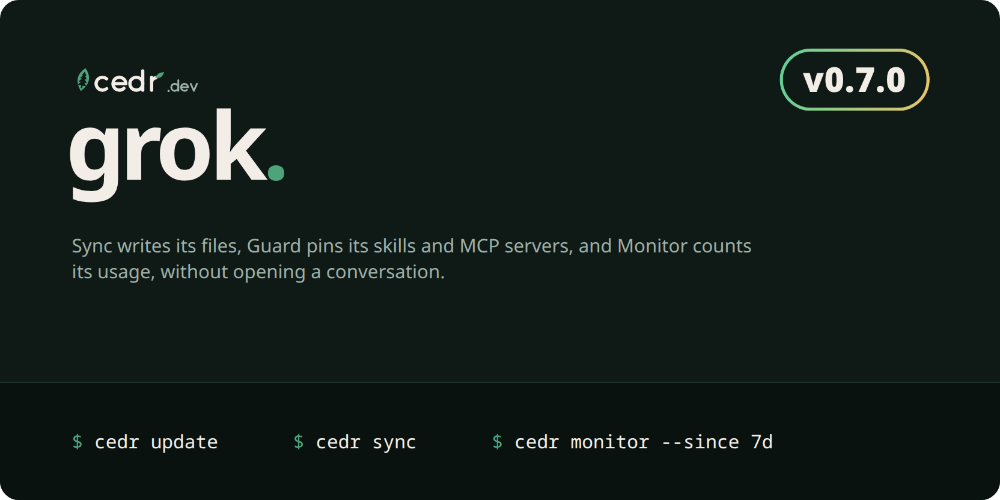

**v0.7.0** · 14 changes from 1 contributor

### Highlights
cedr now works with Grok Build. Sync writes its files, Guard pins its skills and MCP servers, and Monitor counts its usage without opening a conversation. Route and Council don't cover it yet. cedr is also now developed in public in this repo, with issues and pull requests here. **Upgrade step:** none; cedr updates itself. A lock file that holds a Grok Build entry needs this version or later to read it.

### Features
- **Sync** has an opt-in `grok` target that writes and imports `.grok/` files: MCP servers and permission rules in `.grok/config.toml`, plus rules, skills and hooks. Grok Build holds a repo's files back until the folder is trusted, and `cedr sync` says so. Contract: [docs/sync.md](https://github.com/Sheernox/cedr/blob/v0.7.0/docs/sync.md).
- **Guard** discovers `.grok/config.toml` and `.grok/skills/`, so `cedr guard lint`, `lock` and `verify` cover them. Contract: [docs/design.md](https://github.com/Sheernox/cedr/blob/v0.7.0/docs/design.md).
- **Monitor** has a `grok` source that reads only each session's `usage.json` and `events.jsonl`, never its conversation files. It counts a forked session's copied turns once, and a subagent's usage once inside its parent. Contract: [docs/monitor.md](https://github.com/Sheernox/cedr/blob/v0.7.0/docs/monitor.md).
- **Development** moved here: read [CONTRIBUTING.md](https://github.com/Sheernox/cedr/blob/v0.7.0/CONTRIBUTING.md) to report a bug or propose a change.

Full changelog

#### What's Changed
* docs: show the v0.6.0 hero smaller in its release notes
* docs(readme): show all five products in one table so sync and monitor are found
* docs: show the v0.6.0 version in the beta chip's ring, larger
* fix(readme): stack product tiles over names so names stay inside their cells
* ci: pin every action to a commit so a moved tag cannot reach a release
* docs: make this repo the home of cedr development ([#2](https://github.com/Sheernox/cedr/pull/2))
* docs(readme): say that ideas start as issues and focused fixes can be pull requests ([#3](https://github.com/Sheernox/cedr/pull/3))
* feat: add grok build to sync, guard and monitor ([#10](https://github.com/Sheernox/cedr/pull/10))
* fix(monitor): correct grok usage and tool models collected before a session is complete ([#11](https://github.com/Sheernox/cedr/pull/11))
* fix(monitor): replace the app's copy of grok tool rows when their model or subagent mark changes ([#11](https://github.com/Sheernox/cedr/pull/11))
* docs(agents): prepare release pull requests without being asked ([#12](https://github.com/Sheernox/cedr/pull/12))
* build(banner): render the v0.7.0 release hero
* docs: changelog for 0.7.0
* chore(release): cedr 0.7.0

**Full Changelog**: https://github.com/Sheernox/cedr/compare/v0.6.0...v0.7.0

## v0.6.0 (2026-11-01)

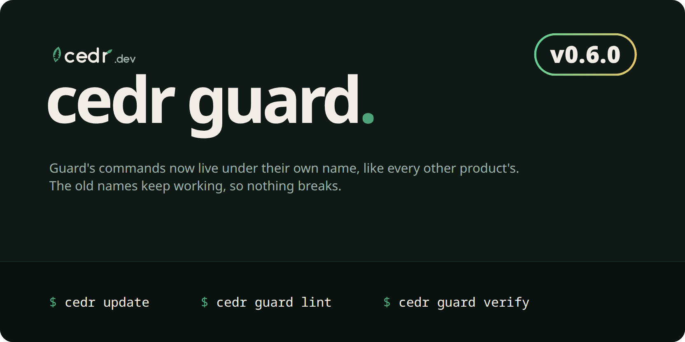

**v0.6.0** · 5 changes from 1 contributor

### Highlights
Guard now has its own command, like every other cedr product: `cedr guard lint`, `lock`, `verify`, `outdated` and `push`. **Upgrade step:** none. cedr updates itself, and the old names such as `cedr lint` still run with the same flags, output and exit codes, so existing CI and scripts keep working.

### Features
- **`cedr guard`** holds all of Guard's commands: `lint`, `lock`, `verify`, `outdated`, `push`, `surface`, `latest` and `diff`. Help and shell completions now list only the new form. Usage events record the name you typed, and `cedr guard outdated` annotations carry the new title. Contract: [docs/design.md](https://github.com/Sheernox/cedr/blob/main/docs/design.md).
- **The GitHub Action** calls the old names on purpose, so a `version` pinned to an earlier release keeps working.

Full changelog

#### What's Changed
* feat(guard)!: move guard's commands under cedr guard like every other product
* build(banner): render release heroes smaller
* build(banner): render the v0.6.0 release hero
* docs: changelog for 0.6.0
* chore(release): cedr 0.6.0

**Full Changelog**: https://github.com/Sheernox/cedr/compare/v0.5.2...v0.6.0

## v0.5.2 (2026-10-31)

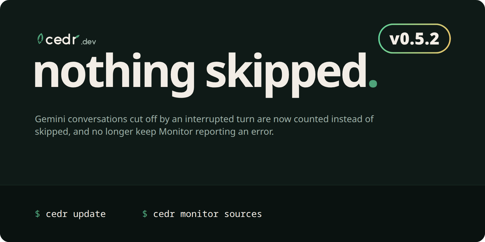

**v0.5.2** · 4 changes from 1 contributor

### Highlights
Monitor now counts Antigravity conversations that an interrupted turn cut off. Before, such a conversation looked as if it were still being written, so it was skipped on every run and `cedr monitor sources` kept reporting Antigravity as an error. **Upgrade step:** none; cedr updates itself.

### Fixes
- An Antigravity conversation with more generations than finished steps is treated as being written only if it changed in the last 10 minutes. Once it has settled, its finished generations are counted, and the unfinished ones show as malformed in `cedr monitor sources`. Contract: [docs/monitor.md](https://github.com/Sheernox/cedr/blob/main/docs/monitor.md).

Full changelog

#### What's Changed
* fix(monitor): read interrupted antigravity conversations instead of skipping them
* build(banner): render the v0.5.2 release hero
* docs: changelog for 0.5.2
* chore(release): cedr 0.5.2

**Full Changelog**: https://github.com/Sheernox/cedr/compare/v0.5.1...v0.5.2

## v0.5.1 (2026-10-31)

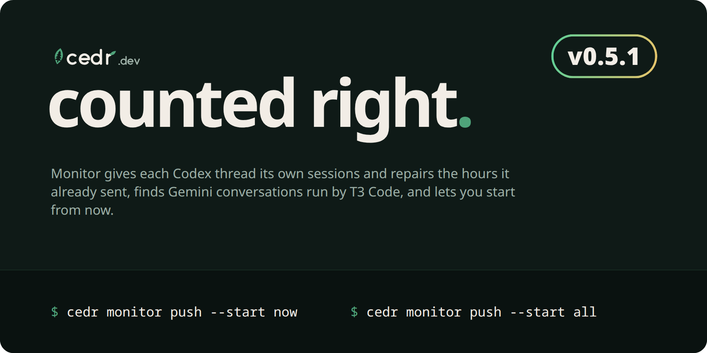

**v0.5.1** · 4 changes from 1 contributor

### Highlights
Monitor counts Codex usage under the thread that produced it, and repairs what it already sent. A Codex rollout can carry responses from another thread (a subagent's or a forked thread's), and until now they all counted as one session. After updating, the first `cedr monitor` run rereads your Codex logs once, and the next `cedr monitor push` resends the affected hours so your organization's totals are not counted twice. Monitor also finds Antigravity conversations that T3 Code runs, and `cedr monitor push --start now` lets a machine send only usage from now on. **Upgrade step:** none; 0.5.0 updates itself.

### Fixes
- Codex responses with a `thread_id` count under that thread's session, not the rollout's ([Sheernox/cedr#1](https://github.com/Sheernox/cedr/issues/1)). Token totals were already right; session counts now are too.
- Hours already pushed under the old sessions are resent once per organization, with an empty row for each old session left without usage, so the app replaces them rather than adding to them.

### Features
- **Antigravity in T3 Code**: conversations under `~/.t3/userdata/providers/antigravity/` are read alongside `~/.gemini/antigravity*/`; a conversation found in both counts once. Contract: [docs/monitor.md](https://github.com/Sheernox/cedr/blob/main/docs/monitor.md).
- **`cedr monitor push --start all|now|<date>`** chooses where your organization's usage begins. It is saved per organization before anything is sent, and every later push (scheduled, automatic or `--full`) keeps to it. Moving it earlier sends the older usage once; moving it later stops sending older usage from the next whole hour but never removes what the app has. Without a choice, the first push sends your history as before and says so. Setup: [cedr.dev/docs/monitor/setup](https://cedr.dev/docs/monitor/setup).

Full changelog

#### What's Changed
* fix(monitor): attribute codex responses to their thread and repair sent hours
* build(banner): render the v0.5.1 release hero
* docs: changelog for 0.5.1
* chore(release): cedr 0.5.1

**Full Changelog**: https://github.com/Sheernox/cedr/compare/v0.5.0...v0.5.1

## v0.5.0 (2026-10-30)

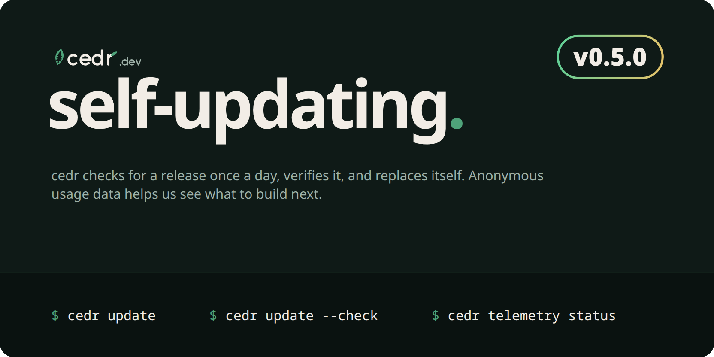

**v0.5.0** · 5 changes from 1 contributor

### Highlights
cedr now keeps itself up to date. `cedr update` installs the latest release after checking it against the release's SHA-256 checksums and test-running the new binary, and once a day cedr does the same in the background. It never updates itself in CI, and an install from `cargo install` or in a directory you cannot write to tells you how to update instead. cedr also sends anonymous usage data, so we can see which commands, platforms and agents matter: the first run says what is sent, and `cedr telemetry off` turns it off. **Upgrade step:** this is the last manual upgrade. Download 0.5.0 as before and replace your `cedr`; from here on it updates itself.

### Features
- **`cedr update`** finds the latest stable release, downloads this platform's archive, checks it against `SHA256SUMS`, confirms the new binary starts and reports the right version, then swaps it in (an atomic rename on Linux and macOS; on Windows the old binary is moved aside and back on failure). `--check` only reports, `--version X.Y.Z` installs a particular release, older ones included, and `--format json` prints the result for scripts. Contract: [docs/update.md](https://github.com/Sheernox/cedr/blob/main/docs/update.md).
- **Daily background update**, on by default: at most once a day a command starts the check in the background, never delaying it, and the next command prints `cedr: updated to 0.5.x`. It only moves forward to a stable release. Turn it off with `cedr update --auto off` or `CEDR_NO_AUTO_UPDATE=1`; a failed update shows in `cedr doctor`, whose version check now points at `cedr update`.
- **Anonymous usage data**: each command records its name, exit code, duration, the cedr version, OS and architecture, which coding agents have their settings folder on the machine, and a few counts, with a random install ID that is not linked to you or your account. Never arguments, paths, repo names, error text or code. Events are sent in the background at most once an hour. `cedr telemetry status` shows what is on; `cedr telemetry off`, `CEDR_TELEMETRY=0` or `DO_NOT_TRACK=1` turn it off, and `off` deletes the install ID and anything not yet sent. Every field: [cedr.dev/docs/cli/telemetry](https://cedr.dev/docs/cli/telemetry); contract: [docs/telemetry.md](https://github.com/Sheernox/cedr/blob/main/docs/telemetry.md).

Full changelog

#### What's Changed
* feat(cli): self-update with cedr update and opt-out anonymous telemetry
* docs(agents): open every changelog entry with a hero image of the release
* build(banner): render release banners alongside the readme banner
* docs: changelog for 0.5.0
* chore(release): cedr 0.5.0

**Full Changelog**: https://github.com/Sheernox/cedr/compare/v0.4.2...v0.5.0

## v0.4.2 (2026-10-30)

**v0.4.2** · 4 changes from 1 contributor

### Highlights
Release archives are named by operating system and architecture instead of the Rust target triple: `cedr-linux-x86_64.tar.gz`, `cedr-linux-arm64.tar.gz`, `cedr-macos-arm64.tar.gz`, `cedr-macos-x86_64.tar.gz` and `cedr-windows-x86_64.zip`, each unpacking to a folder of the same name. The GitHub Action downloads the new names; earlier releases keep their old ones. Release notes are now this changelog's entry for each tag.

### Fixes
- Archive names no longer carry the target triple's `unknown`, `apple` and `pc` vendor fields.
- Each GitHub release now publishes its changelog entry instead of a generated one-line compare link.

Full changelog

#### What's Changed
* ci(release): publish each tag's changelog entry as its release notes
* build(release): name archives by os and architecture
* docs: changelog for 0.4.2
* chore(release): cedr 0.4.2

**Full Changelog**: https://github.com/Sheernox/cedr/compare/v0.4.1...v0.4.2

## v0.4.1 (2026-10-30)

**v0.4.1** · 5 changes from 1 contributor

### Highlights
Fixes from running the GitHub Action, the hourly push timer and Sync end to end on real repos, Linux and Windows. No upgrade step; if you pinned the action, move to `Sheernox/cedr@v0.4.1`.

### Fixes
- `cedr sync` no longer writes settings files that hold only empty lists when a repo has no permissions or hooks, and says once, instead of per entry, when MCP servers, permissions and hooks reach no agent.
- `cedr monitor push` checks its organization and key before reading any log, so a machine with nowhere to send counts says so at once.
- Scheduled pushes start up to ten random minutes late, so machines do not all push on the hour, and Windows no longer leaves the task XML in the home folder.
- `cedr outdated --format github` puts each annotation on `.cedr/guard.lock` instead of the workflow file.

Full changelog

#### What's Changed
* fix(sync): write no empty settings files, and note unused servers once instead of per entry
* fix(monitor): check where a push goes before reading logs, spread scheduled pushes, and tidy the windows task
* fix(guard): put cedr outdated annotations on the lock file instead of the workflow
* docs: changelog for 0.4.1
* chore(release): cedr 0.4.1

**Full Changelog**: https://github.com/Sheernox/cedr/compare/v0.4.0...v0.4.1

## v0.4.0 (2026-10-30)

**v0.4.0** · 14 changes from 1 contributor

### Highlights
Two new tools and a checkup. **Sync** keeps one agent setup in `.cedr/` and writes every agent's own files from it (AGENTS.md, Claude Code, Codex, Cursor, Gemini CLI, Copilot, opencode and Antigravity), fails CI on drift, and applies your organization's rules. **Monitor** reads each coding agent's local logs and plan readings and reports tokens, spend at API list prices, cache use, sessions, errors and plan limits, and sends counts (never prompts or code) to the app's Monitor page. **`cedr doctor`** checks everything cedr needs and prints the fix for each problem. Guard now reads all eight agents' configs and shows what a newer server version would change before you take it. No upgrade step: existing routes, history and locks are unchanged.

### Fixes
- Monitor's push reads its organization only from your own `~/.config/cedr/monitor.toml` or `routes.toml`, never from a repo's `.cedr/routes.toml`, so a cloned repo cannot choose where your API key goes.
- Claude Code tool calls written without a timestamp are counted in the hour they happened instead of at 1970.

### Features
- **`cedr sync`.** `init` imports a repo's existing agent files into `.cedr/` (replacing literal secrets with `${NAME}` references); `cedr sync` compiles rules, skills, MCP servers, permissions and hooks into each agent's native files, merging settings files instead of replacing them; `check` fails on drift, hand edits and broken org rules (CS001-CS105), with `--format github`; `pull` vendors org rules into `.cedr/org-rules.json`; `push` reports each repo to the app's Sync page. ([docs](docs/sync.md), [guide](https://cedr.dev/docs/sync))
- **`cedr monitor`.** Incremental collectors for Claude Code, Codex, Gemini CLI, Copilot CLI, opencode, Muse Code and Antigravity into a local store; reports by model, agent, project, day, hour, session or effort; `sessions`, `limits` (projection and outlook per plan window), `sources`, `push` (hourly counts to the app) and `schedule` (an hourly user timer on Linux, macOS and Windows). ([docs](docs/monitor.md), [guide](https://cedr.dev/docs/monitor))
- **`cedr doctor`.** Checks the CLI version, API key and organization, Route, MCP registrations, Monitor's collectors and schedule, and Sync and Guard in the current repo, each with its fix; `--format json` for agents. ([docs](docs/doctor.md))
- **`cedr outdated`.** Shows newer versions of pinned npm servers and what each would change (tools, descriptions, schemas, hosts, capabilities) without installing or running anything; `cedr push --updates` sends them to the Guard page. ([docs](docs/design.md#updates))
- **Guard reads every agent.** Copilot, opencode and Antigravity MCP configs and the Gemini, Cursor, Copilot and opencode skill folders are linted, locked and verified like the rest. ([docs](docs/design.md#discovery))
- **GitHub Action.** New inputs `sync`, `sync-fix` (a scheduled pull request that repairs Sync drift) and `outdated`; `push-org` also reports Sync and server updates. The action is now named `cedr`.
- **MCP tools.** `cedr mcp` adds `sync_check`, `sync_plan`, `monitor_report`, `monitor_limits`, `monitor_sources` and `doctor`.

Full changelog

#### What's Changed
* docs: add the sync, monitor and doctor design contracts
* feat(monitor): add the shared api price table
* docs(guard): contract every agent's config files, cedr outdated and update reports
* docs(monitor): state the per-row counter ceiling and the app's per-member caps
* feat(monitor): read every coding agent's local usage into a store, report it and push hourly counts
* fix(monitor): send counts the app accepts, read the org only from the person's own config, and explain every flag
* fix(monitor): place untimed records at the file's last time instead of the epoch
* feat(sync): compile agent setup and diagnose local configuration
* fix(sync): retain invalid-source findings and native import notes
* fix(sync): keep front matter on the first line of generated rules
* docs(sync): state the default targets and when doctor goes online
* feat(guard): discover all clients and report npm surface updates
* docs: changelog for 0.4.0
* chore(release): cedr 0.4.0

**Full Changelog**: https://github.com/Sheernox/cedr/compare/v0.3.0...v0.4.0

## v0.3.0 (2026-10-30)

**v0.3.0** · 9 changes from 1 contributor

### Highlights
Guard is back, in preview. Check the skills and MCP servers your agents load on every pull request with the new GitHub Action, keep all of Guard's files in `.cedr/`, tune lint per repo with `.cedr/guard.toml`, and send each repo's pins and findings to the app's new Guard page with `cedr push`. Upgrade step: run `cedr lock` once in each locked repo; it moves `cedr.lock` to `.cedr/guard.lock` (0.3.0 still reads the old path). The hosted MCP server moved to `https://mcp.cedr.dev/mcp`.

### Fixes
- Findings, registry errors and config parse errors no longer show a URL's user info, query or fragment, and parse errors no longer quote the offending line.
- A skill folder that links outside the repo is reported as CG010 and skipped, instead of stopping the whole run.
- `cedr lock` writes through a temporary file and never writes through a link that leaves the repo.
- Piping output into a command that exits early (`cedr route history | head`) ends quietly instead of panicking.
- Every flag has help text, and a missing `routes.toml` points at a starter file.

### Features
- **GitHub Action.** `uses: Sheernox/cedr@v0.3.0` installs a released `cedr` checked against `SHA256SUMS`, then runs `cedr lint` and `cedr verify` with findings as pull request annotations. Inputs: `version`, `path`, `strict`, `verify` and `push-org`. ([docs](docs/design.md#github-action), [guide](https://cedr.dev/docs/guard#check-every-pull-request))
- **`--format github`.** `cedr lint` and `cedr verify` print GitHub Actions workflow commands with a summary line. ([docs](docs/design.md#lint-rules))
- **`.cedr/` repo files and `.cedr/guard.toml`.** The lock lives at `.cedr/guard.lock` next to `.cedr/surfaces/`. `guard.toml` adds skill folders and skips lint rules everywhere or under some paths; `verify` is never suppressed. ([docs](docs/design.md#repo-files))
- **`cedr push`.** Sends a repo's pinned skills and servers, its lint findings and its drift from the lock to your cedr.dev organization's Guard page. It never sends file contents, env values, launch commands or URL queries; in CI, `--org` alone never reads the checkout's config. A list cut to the app's limits prints a warning. ([docs](docs/design.md#push))
- **Old text in `cedr diff`.** Description and schema changes carry `before`, and text output prints it on a `was:` line. ([docs](docs/design.md#diff))
- **`cedr completions <shell>`.** Completion scripts for bash, zsh, fish, PowerShell and Elvish, plus examples in `cedr --help`.

Full changelog

#### What's Changed
* docs(guard): contract the .cedr/ repo files, guard.toml, CG010, github annotations, cedr push and the action
* feat(guard): keep guard files in .cedr/, add guard.toml, CG010, github annotations, cedr push and the action
* docs(guard): describe the .cedr/ lock, cedr push and the github action in the readmes
* fix(guard): redact url secrets in findings, keep lock writes inside the repo, and stop ci config redirecting the push key
* fix(cli): keep url secrets out of registry and toml errors, explain every flag, and end quietly on a closed pipe
* fix(guard): match the app's 2 MiB push limit and record its per-org storage cap
* feat(guard): warn when cedr push cuts a list to the app's limits
* docs: changelog for 0.3.0
* chore(release): cedr 0.3.0

Changes land in the cedr.dev source tree and arrive here together in one export commit, so this release has no pull requests of its own.

**Full Changelog**: https://github.com/Sheernox/cedr/compare/v0.2.0...v0.3.0

## v0.2.0 (2026-10-30)

**v0.2.0** · 4 changes from 1 contributor

### Highlights
Try new model versions on small work before they take everything. Let a cheap model draft and a judge decide whether the draft stands or goes to a stronger model. Give a change the council blocked one round to answer before the gate stands. See how every route and council performs, with time to verdict, trial results and revision outcomes. Update every machine to 0.2.0 before using routes from cedr.dev: 0.1.0 rejects the new route fields.

### Fixes
- A route file without an `[evaluation] last` date no longer warns that it is stale.
- A pick that keeps the work no longer reports a run id that nothing records.

### Features
- **Preview versions.** With `[evaluation] models` set, a model version it doesn't list only takes `--size small` picks (`preview = "trial"`, the default), so it builds a track record before medium and large work moves to it; `hold` keeps it off every pick and `use` always takes the newest. Such picks show ` (preview)` in their reason and get their own row in stats. ([docs](docs/route.md#preview-versions), [guide](https://cedr.dev/docs/route#drafts-judges-and-new-models))
- **Cascades.** A route can name a `judge` route and an `escalate` route. Pick the judge with `cedr route pick <judge> --judges <draft pick>`; it replies `ACCEPT` or `ESCALATE: <reason>`, and an escalation is picked with `--escalates <draft pick>`. All three picks share one run in history. ([docs](docs/route.md#cascade))
- **Council revision rounds.** Councils set `rounds` (0 to 3, default 1). A blocked merge with a round left reports `next: revise` and writes one revision brief with every finding, most severe first and dissent kept (`cedr council merge --format brief`); review again with `--round 2`. ([docs](docs/council.md#critique-and-revise))
- **Council records and stats.** Council plans share one run id; `cedr council merge --run <id>` records the gate, round and finding counts (never findings) and syncs them to cedr.dev. `cedr council stats` reports passes, blocks, revisions and passes after revision. ([docs](docs/council.md#record))
- **Richer route stats and history.** `cedr route stats` adds `--since`, trial rows, median minutes to a verdict, and judged and escalated counts for cascades; `cedr route history` lists recent picks and council results. ([docs](docs/route.md#history-and-verdicts))
- **`cedr route import`.** Converts a T3 Code delegation `routing.toml` into a `routes.toml`, refusing fields it does not know. ([docs](docs/route.md#import))
- **MCP tools.** New `route_stats`, `route_history` and `council_stats`; `route_pick` takes `judges` and `escalates`, and `council_merge` takes `rounds`, `round` and `run`. ([docs](docs/route.md#mcp-tools))

Full changelog

#### What's Changed
* feat(route): hold unevaluated model versions, add judged cascades and council revision rounds
* docs(route): contract linked cascade and council runs, council records, richer stats and import
* feat(route): link cascade and council runs, record council results, add history, richer stats and import
* chore(release): cedr 0.2.0

Changes land in the cedr.dev source tree and arrive here together in one export commit ([`1e6947f`](https://github.com/Sheernox/cedr/commit/1e6947f)), so this release has no pull requests of its own.

**Full Changelog**: https://github.com/Sheernox/cedr/compare/v0.1.0...v0.2.0

## v0.1.0 (2026-10-29)

**v0.1.0** · first release

### Highlights
Route picks the coding agent, model and effort for each kind of work, balanced by the room left on each plan you pay for. Council turns several vendors' reviews into one gate. Prebuilt binaries for Linux, macOS and Windows.

### Features
- **`cedr route`.** Picks from `routes.toml` with route tags, local history, verdicts, stats and sync with cedr.dev. ([docs](docs/route.md))
- **`cedr council`.** Plans a multi-vendor review and merges the reports into one gate with a quorum and a blocking severity. ([docs](docs/council.md))
- **`cedr mcp`.** The same tools over MCP on stdio. ([docs](docs/route.md#mcp-tools))

Full changelog

**Full Changelog**: https://github.com/Sheernox/cedr/commits/v0.1.0

